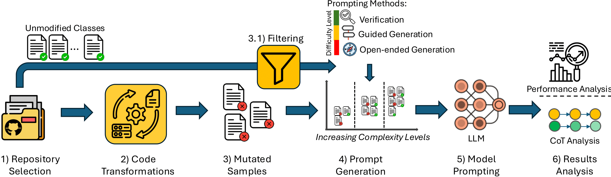

# _Efficient Interns or Senior Engineers?_ An Empirical Study of LLMs’ Software Design Capabilities




> Large language models (LLMs) are being increasingly adopted in the software engineering domain, yet the robustness of their grasp on core software design concepts remains unclear. We conduct an empirical study to systematically evaluate their understanding of cohesion (intra-module) and coupling (inter-module). We programmatically generate poorly designed code fragments and test the DeepSeek-R1 model family (14B, 32B, 70B) under varying levels of guidance, from simple _Verification_ to _Guided_ and _Open-ended Generation_, while varying contextual noise by injecting distractor elements. While models exhibit a solid baseline understanding of both concepts in ideal conditions, their practical knowledge is fragile and highly asymmetrical. Reasoning about coupling proves brittle; performance collapses in noisy, open-ended scenarios, with F1 scores dropping by over 50%. In contrast, the models' analysis of cohesion is remarkably robust to internal noise in guided tasks, showing little performance degradation. However, this resilience also fails when all guidance is removed. Reasoning-trace analysis confirms these failure modes, revealing _cognitive shortcutting_ for coupling versus a more exhaustive (yet still failing) analysis for cohesion. To summarize, while LLMs can provide reliable assistance for recognizing design flaws, their ability to reason autonomously in noisy, realistic contexts is limited, highlighting the critical need for more scalable and robust program understanding capabilities.

This repository contains two main subprojects. The first is a Java project that is used to generate Java classes that exhibit tight coupling and loose cohesion. The second is a Python project that contains the logic to run sampling, post processing and inference.

## Requirements
Some steps of the data generation process requires [DesigniteJava](https://www.designite-tools.com/products-dj) that is used to calculate the YALCOM of each class. Hence, you need to download its JAR file. In addition, we use [OpenRouter](https://openrouter.ai/) API nodes to run model inference. First, you will need to generate an API key (see[docs](https://openrouter.ai/docs/features/provisioning-api-keys)). Second, it should be stored in an env variable called `OPENROUTER_API_KEY`.

## Models Under Test

| Model | OpenRouter Slug | Huggingface Slug |
| :--- | :--- | :--- |
| Deepseek R1 14B | `deepseek/deepseek-r1-distill-qwen-14b` | `deepseek-ai/DeepSeek-R1-Distill-Qwen-14B` |
| Deepseek R1 32B | `deepseek/deepseek-r1-distill-qwen-32b` | `deepseek-ai/DeepSeek-R1-Distill-Qwen-32B` |
| Deepseek R1 70B | `deepseek/deepseek-r1-distill-llama-70b`| `deepseek-ai/DeepSeek-R1-Distill-Llama-70B` |

## Data Generation
### Overview
We use [Spoon](https://spoon.gforge.inria.fr/) to introduce a set of perturbations that generate suboptimal source code from a design a perspective, i.e., tightly coupled and loosely cohesive code fragments. To build the executable JAR file, first, navigate to the project's source directory `data-generator` and build the project:

```bash
mvn clean package
```
If successfull, a JAR file `data-generator-1.0-SNAPSHOT-jar-with-dependencies.jar` will be generated and stored in the `data-generator/target` directory.  

### Generating Samples for Coupling Experiments

As described in the paper, there are three code transformations that generate tightly coupled pairs of classes: Direct Instantiation of Dependencies, Unused Injected Dependency and Indirect Instantiation of Dependencies. For more details on each transformation, please check Section 3.2 of the manuscript.  

To apply these transformations, execute the `run_mutations.sh` bash script in the `scripts` folder as such:

```bash
./run_mutations.sh <INPUT_DIR> <OUTPUT_DIR>
```

The `<INPUT_DIR>` variable should point to a directory that contains valid Maven projects. The `<OUTPUT_DIR>` represents the output directory where the results of transformation will be saved.  

Upon successful execution, the output directory should files that follow these naming patterns:  
- `<PROJECT_NAME>_mutated_classes_{did | uid | iid}.json`: A JSON file that contains the Java classes were transformed using the DID (or UID, or IID) transformations, and the dependency chains of its dependencies.
- `<PROJECT_NAME>_transformed_{directinstantiation | unusedinjecteddependency | factorymethodobfuscator}`: The transformed version of the project after applying the transformations.
- `<PROJECT_NAME>_disjointPairs.json` all disjoint pairs that are described in Section 3.4
- `<PROJECT_NAME>_instantiationremover`: the version of the project were we removed statements that have direct instantiation. These will be used later in conjuction with the `<PROJECT_NAME>_disjointPairs.json` file. This is important to ensure that only the mutated classes exhibit tight coupling.  

Since the transformations do not guarantee that the set of transformed classes will be the same across all transformations, the `llm_experiments/prompt/coupling/keep_overlapping_classes.py` should be executed. This script will generate a final JSON called `<PROJECT-NAME>_coupling_common.json` that contains the paths of the Java classes that were transformed using ALL transformations. For the script to work, you need to change the variable `target_directory` at L112 to point to the `<OUTPUT_DIR>` value that was set when executing `run_mutations.sh`.  

The next step is to generate YML config files for each processed Maven project. To do so, execute the `llm_experiments/prompt/config_generator.py` script as follow:

```
python3 config_generator.py \
    --root_dir <VALUE> \          # This should be the same as the previous `<OUTPUT-DIR>` value.
    --output_dir <VALUE> \        # The directory where the prompts will be saved.
    --ymls_output_dir <VALUE> \   # The directory where the YAML config files will be saved.
    --seed <VALUE> \              # Seed value to control randmoness.
    --n_shuffles <VALUE> \        # Number of shuffles to be generated.
    --perturbation_types <VALUE>  # did, uid, or fmo
```

Note that this step should be executed for each transformation. To generate the prompts, execute the `scripts/generate_prompt.sh` bash script:

```
./scripts/generate_prompt.sh <YML-PATH>
```
where `<YML-PATH>` should have the same value as the `ymls_output_dir` argument from the previous script.  

The final step, is to sample from the set of all generated prompts as described in Section 3.6. This is done by executing the `llm_experiments/models/sampler.py` script. The variables `data_path`, `task` and `code_transformation` should be set to the directory that contains the prompts, the task name (coupling or cohesion) and code transformation name.
### Generating Samples for Cohesion Experiments

The first is to run Designite Java on the list of Maven projects. This is done by executing the `scripts/run_designite.sh` script as such:

```
./scripts/run_designite.sh \
  <PATH-TO-DJ-JAR> \  # Path to DesigniteJava JAR file.
  <INPUT-DIR> \       # Path to directory containing Maven projects.
  <OUTPUT-DIR>        # Path to the output directory where results will be stored.
```

To generate the cohesion prompts execute the `scripts/generate_cohesion_prompts.sh` as follow

```
./scripts/generate_cohesion_prompts.sh \
  <JAR-FILE> \          # Path to the data generation JAR file
  <DJ-OUTPUT-DIR>  \    # Path to the folder containing the DesigniteJava results. Should be the same as <OUTPUT-DIR> from the previous step.
  <RAW-PROJECTS-DIR> \  # Path to the folder containing the Maven projects. Should be the same as <INPUT-DIR> from the previous step.
  <OUTPUT-DIR>          # The directory where the prompts will be stored.
```

Finally, run sampling procedure the same way it is ran in the coupling stage.

## Running Inference

To run inference, execute the `llm_experiments/models/parallel_inference.py` file as follows:

```
python3 -m models.parallel_inference \
--provider "openrouter" \ 
--model_name "deepseek-r1-70b" \ #  Other options: "deepseek-r1-32b" and "deepseek-r1-14b"
--prompts_file="" \ # Picked file generated after executing the sampling procedure.
--output_folder=""  \ # Output directory where the responses will be stored.
--reasoning 

```

## Compile Results

The scripts used to calculate the performance metrics for the coupling and cohesion experiments are `llm_experiments/evaluation/coupling_main.py` and `llm_experiments/evaluation/cohesion_main.py`, respectively. In each file the variable `ROOT_RESULTS_FOLDER` must be set to the folder where the results of inference are stored. The `mutation` variable contains the code transformation name.